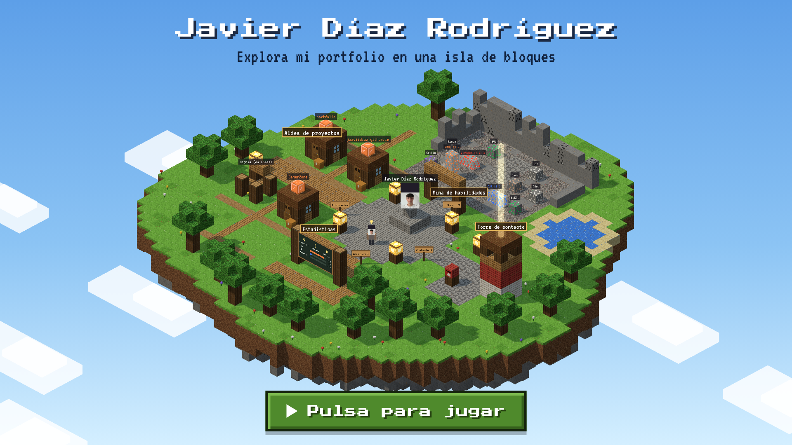

Estudiante del Técnico Superior en Desarrollo de Aplicaciones Multiplataforma (DAM) en Davante Medac Nova (Málaga). Me gusta construir interfaces limpias y usables, estructurar bien la lógica de las aplicaciones y resolver problemas con constancia, trabajo en equipo y aprendizaje continuo.

### Tecnologías

Sigo profundizando en HTML5, CSS3, JavaScript, Java, Kotlin y Git.

Quiero aprender Python, Spring Boot y GitHub.

### En qué me quiero enfocar

Me interesa seguir creciendo en el desarrollo de aplicaciones y software, especialmente en la creación de interfaces web cuidando la estructura, el diseño y la experiencia de usuario.
